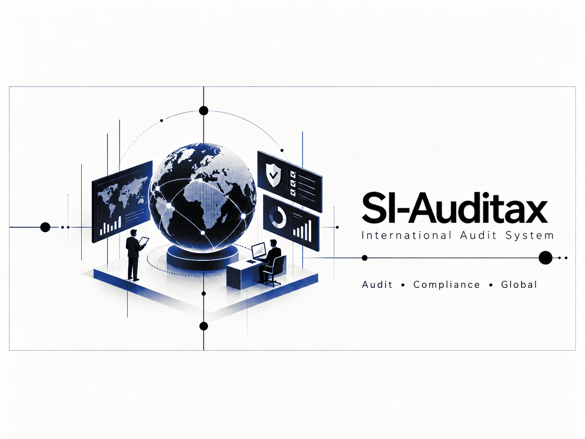

### An international audit workflow platform built to make evidence, risk, workpapers, and accountability traceable.

## Overview

SI-Auditax centralizes the operational lifecycle of an audit: organizations and engagements, workpapers, evidence, risks, findings, action plans, team tasks, time budgets, and an auditable activity history.

## My Contributions

- Designed and implemented full-stack audit workflows
- Connected role-aware interfaces to a structured REST API
- Built document, workpaper, risk, finding, task, and time-tracking capabilities
- Prepared repeatable Windows-oriented deployment and operational checks

## Project Highlights

- Role- and organization-aware access
- Versioned workpapers and supporting evidence
- Risk, finding, and action-plan traceability
- Operational monitoring and audit logs

## System Architecture

A React and TypeScript client communicates with a Django REST API backed by PostgreSQL. Documents remain in controlled file storage while relational metadata preserves workflow state and traceability.

## Tech Stack

`React 18` `TypeScript` `Vite` `Tailwind CSS` `Python` `Django 5` `Django REST Framework` `PostgreSQL`

## Results

- Unified previously separate audit activities in one workflow
- Made ownership and status visible across the engagement lifecycle
- Established repeatable health, build, and release checks

## Screenshots

Additional sanitized product screenshots will be added when they can be shared without exposing private data or infrastructure.

## What I Learned

Complex business software succeeds when permissions, traceability, and document states are modeled as first-class domain concepts rather than added after the interface is built.

## Privacy and Ownership

> This is a documentation-only portfolio case study. The production source code, infrastructure details, client data, and internal configuration are private and are not included in this repository.

## Contact

- [LinkedIn](https://www.linkedin.com/in/dev-ai-erick)
- [GitHub](https://github.com/DevDope)

---

This repository is maintained as a professional portfolio case study. No license to proprietary source code or private assets is granted.
